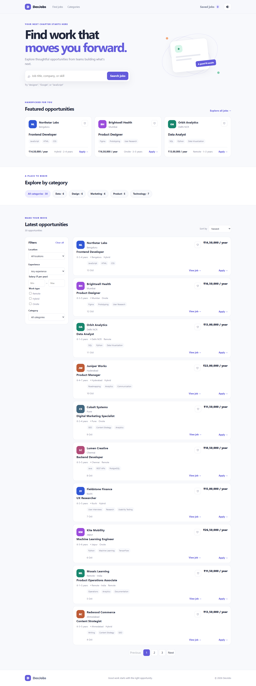
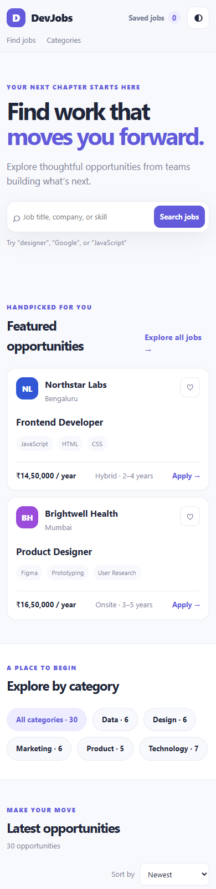

# DevJobs Portal

A responsive, vanilla JavaScript job portal for browsing, filtering, saving, and applying to sample jobs.

## Run locally

The page loads job records from JSON and uses native JavaScript modules, so serve the project over HTTP instead of opening index.html directly.

- Open the folder with VS Code and start Live Server, or
- From the project folder, run: python -m http.server 8000
- Visit http://localhost:8000

The project uses only HTML, CSS, and browser JavaScript. It has no framework, library, build step, or npm dependency.

## Features

- Home page with a hero, featured jobs, category shortcuts, search, and latest opportunities.
- Thirty sample jobs with company, role, salary, experience range, job type, location, category, skills, and role details.
- Case-insensitive, partial search across job titles, company names, and skills.
- Combined location, experience-range, salary, Remote/Hybrid/Onsite, and category filters.
- Newest, Highest Salary, Lowest Salary, and Alphabetical sorting.
- Ten jobs per page with Previous, Next, and numbered page controls.
- Job details with responsibilities, requirements, benefits, skills, compensation, experience, and location.
- A four-step application dialog with validation, review, confirmation ID, and applied date.
- Saved jobs, recently viewed jobs, application records, theme, page selection, and an in-progress text draft persisted in Local Storage.
- Responsive desktop and mobile layouts, dark/light theme, empty states, error retry state, and loading skeletons.

## Apply flow and data storage

The application form accepts PDF, DOC, and DOCX resume and optional cover-letter files up to 5 MB each. Since this assignment is a static front-end project with no server, submission does not send an application to an employer. The browser validates the selected files and stores the application fields and file names/sizes in that browser’s Local Storage. File contents are not uploaded or persisted. Local Storage is scoped to the current browser profile and device.

## Project structure

- index.html and job-details.html
- css/style.css and css/responsive.css
- js/jobs.js, js/app.js, js/details.js, and js/storage.js
- data/jobs.json
- assets/screenshots/devjobs-desktop.png and assets/screenshots/devjobs-mobile.png
- ASSIGNMENT_PROGRESS.md and DESIGN_QUESTIONS.md

## Screenshots

### Desktop

### Mobile

## Local Storage keys

- devjobs.bookmarks
- devjobs.recentlyViewed
- devjobs.applications
- devjobs.applicationDraft
- devjobs.theme
- devjobs.pagination
